<p align="center"></p>

<h1 align="center">Sightline</h1>

<p align="center"><a href="README.md">English</a> · <b>Русский</b></p>

<p align="center">Посмотрите, как учатся модели машинного обучения. Выберите одну из 22 настоящих моделей, дайте ей данные, нажмите <b>«Обучить»</b> и смотрите, как движется граница решений, падают потери и как модель шаг за шагом принимает решение. Без интернета, на русском или английском.</p>

<p align="center">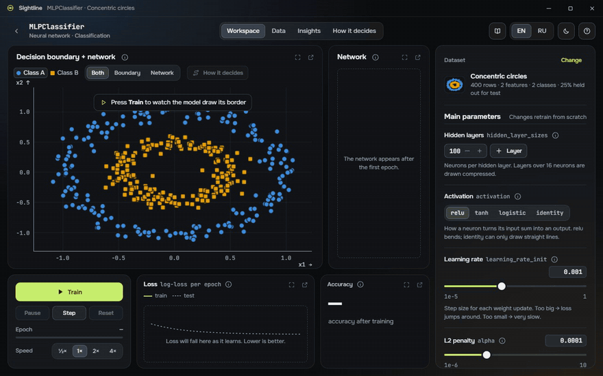</p>

## Скачать

Установщик для своей системы возьмите в [последнем релизе](../../releases/latest):

| Система | Файл |
|---|---|
| Windows 10 / 11 (x64) | `Sightline_<версия>_x64-setup.exe` (или `Sightline_<версия>_x64_en-US.msi`) |
| macOS 11+ — Apple Silicon | `Sightline_<версия>_aarch64.dmg` |
| macOS 11+ — Intel | `Sightline_<версия>_x64.dmg` |
| Linux (x64) | `Sightline_<версия>_amd64.AppImage`, `Sightline_<версия>_amd64.deb` или `Sightline-<версия>-1.x86_64.rpm` |

Python уже внутри, больше ничего ставить не нужно. В `SHA256SUMS.txt` в релизе — контрольные суммы всех файлов.

## Возможности

- **22 модели, все настоящие:** 20 моделей scikit-learn (линейные, деревья и ансамбли, SVC, k-NN, наивный Байес, MLP, k-средних, DBSCAN, PCA), а также CatBoostClassifier и CatBoostRegressor, которые читают текстовые столбцы напрямую (`cat_features`, без one-hot).
- **Обучение вживую:** граница решений плавно меняется на GPU с частотой 60 кадров/с, панель потерь никогда не пустая (у каждой модели своё состояние), «Пауза», «Шаг», «Сброс» и скорость срабатывают за 100 мс, а шкала времени прокручивает назад до 500 записанных кадров.
- **Как решает:** пошаговый разбор настоящего вычисления для любой точки — путь по дереву, голосование, вклад каждой стадии, `coef_ × x`, соседи, прямой проход сети, расстояния до центров.
- **Свои данные:** готовые наборы (луны, облака, круги, спирали, XOR, регрессия), редактор таблицы как в электронной таблице с импортом и экспортом CSV, генератор по правилам и «Обзор данных» (гистограммы, матрица диаграмм, ящики с усами, выбросы, корреляция, масштабирование). Щелчок добавляет точку, перетаскивание двигает, Alt+щелчок удаляет — модель переобучается прямо во время правки.
- **Справочник:** глава о каждой модели — идея, разобранный пример с настоящими числами, формулы, где работает и где нет, таблица параметров, код на Python, который запускается, и кнопка «Попробовать в приложении».
- **Удобство:** панели можно двигать и стыковать (раскладка сохраняется для каждой модели), тёмная и светлая темы, русский и английский переключаются на лету, управление с клавиатуры, масштаб и сдвиг на каждом графике.

## Скриншоты

| | Русский | English |
|---|---|---|
| Выбор модели | 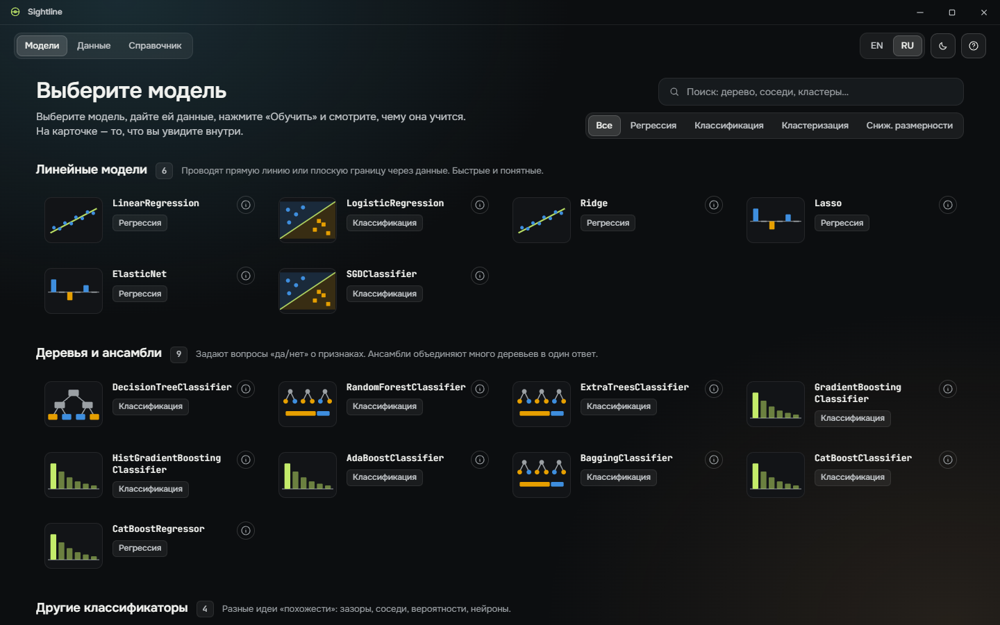 | 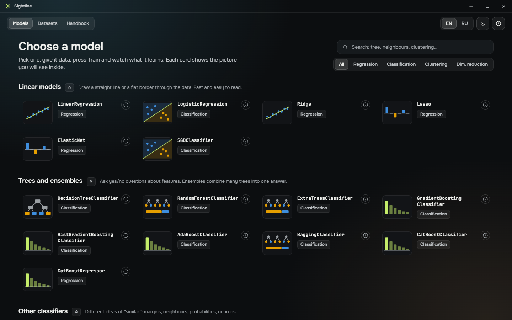 |
| Рабочая область после обучения | 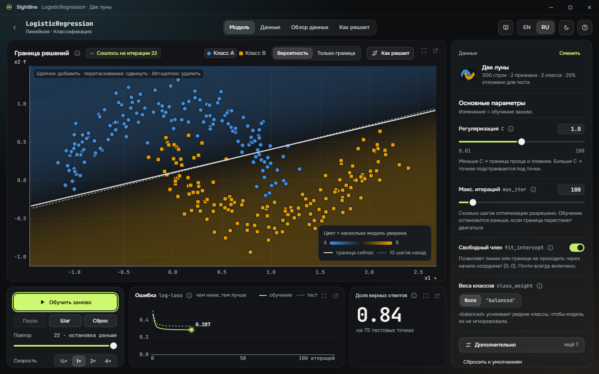 | 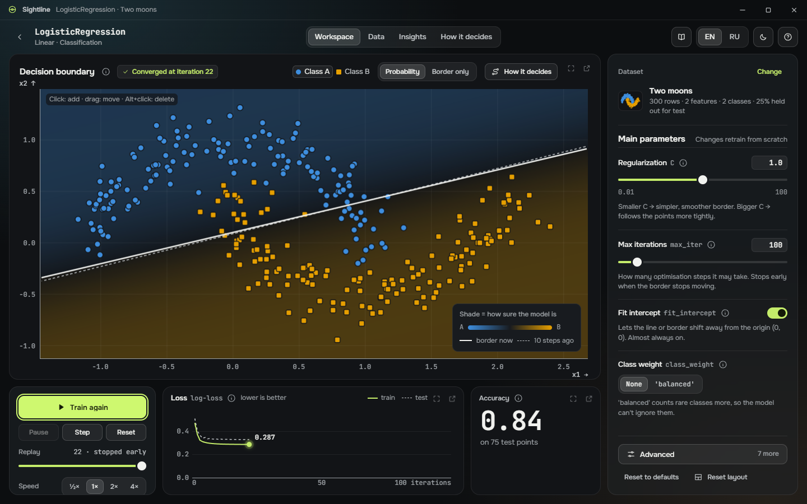 |
| Как решает | 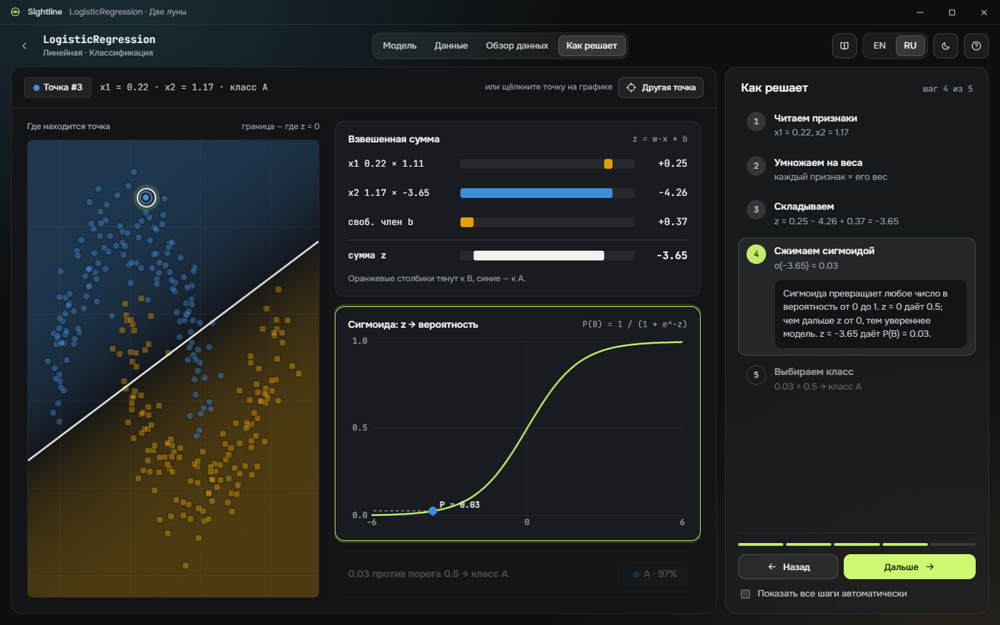 | 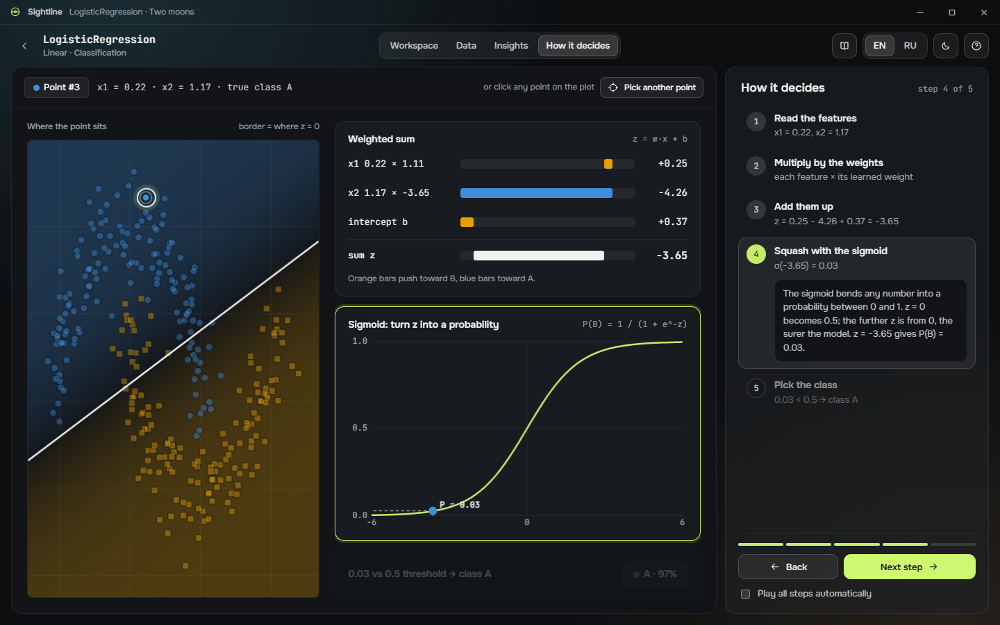 |
| Редактор данных | 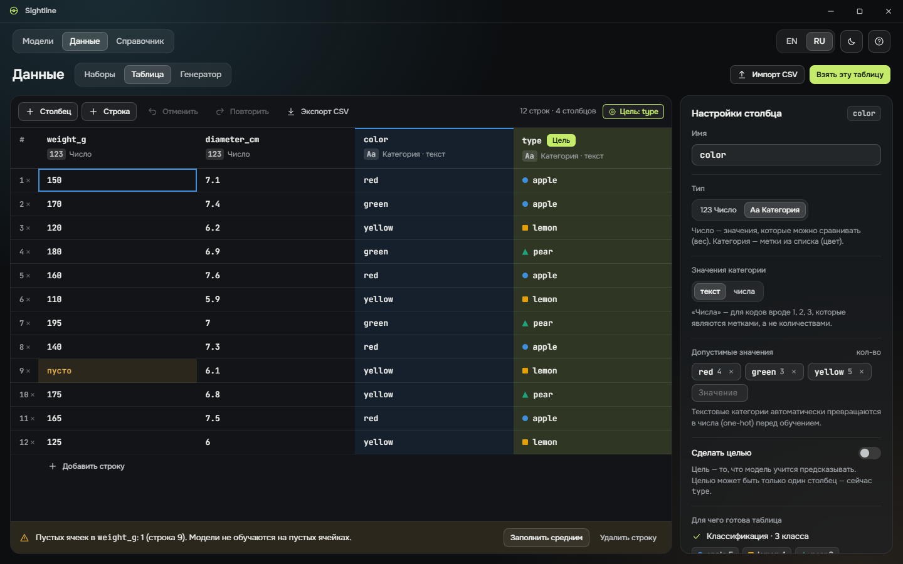 | 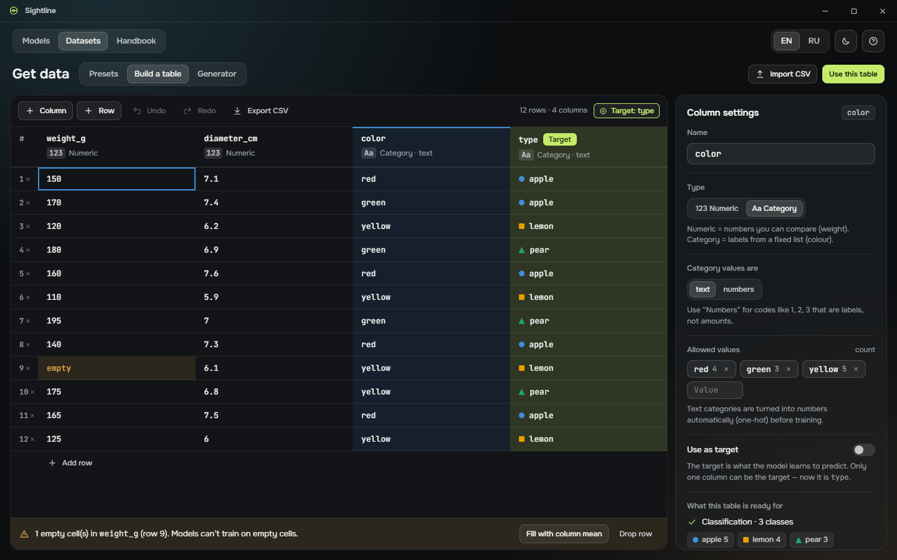 |
| Справочник | 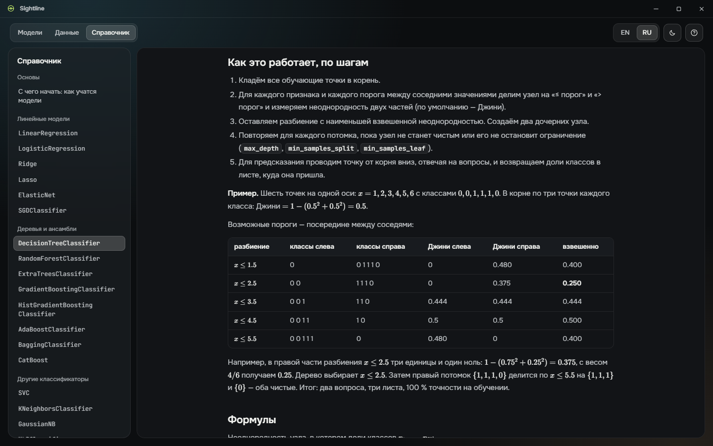 | 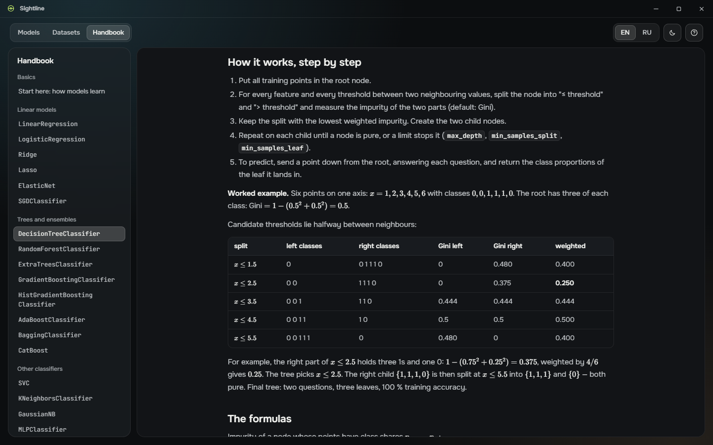 |

## Установка

Сборки релиза **не подписаны**, если в проекте не заданы секреты для подписи, поэтому при первом запуске нужен один лишний щелчок.

**Windows.** Запустите `Sightline_<версия>_x64-setup.exe`. Программа ставится для текущего пользователя (права администратора не нужны), добавляет ярлык в меню «Пуск», на последней странице предлагает ярлык на рабочем столе и регистрирует удаление в *Параметры → Приложения*. Если SmartScreen пишет *«Система Windows защитила ваш компьютер»*, нажмите **Подробнее → Выполнить в любом случае**. На Windows 10 без WebView2 установщик скачает его сам.

**macOS.** Откройте `.dmg` и перетащите **Sightline** в *Программы*. Неподписанное приложение Gatekeeper в первый раз блокирует: щёлкните Sightline в *Программах* правой кнопкой (или с Control) → **Открыть** → **Открыть**. В macOS 15 и новее откройте приложение один раз, затем в *Системные настройки → Конфиденциальность и безопасность* нажмите **Всё равно открыть**. То же самое из терминала:

```bash
xattr -dr com.apple.quarantine /Applications/Sightline.app
```

**Linux.**

```bash
# AppImage: без установки
chmod +x Sightline_*_amd64.AppImage && ./Sightline_*_amd64.AppImage
```

```bash
# Debian / Ubuntu (заодно ставит зависимости WebKitGTK)
sudo apt install ./Sightline_*_amd64.deb
```

```bash
# Fedora / RHEL / openSUSE
sudo dnf install ./Sightline-*.x86_64.rpm
```

## Быстрый старт

1. На главном экране нажмите **«Впервые с машинным обучением? Начните здесь»** — это двухминутный запуск с подсказками, — или выберите любую карточку. Круглая кнопка **i** на карточке рассказывает о модели: что она делает, когда её брать, одна сильная и одна слабая сторона.
2. Рабочая область открывается с подходящим модели набором данных. Нажмите **«Обучить»** (или пробел).
3. Следите за границей и панелью потерь. **«Пауза»**, **«Шаг»** и шкала времени — чтобы пересмотреть обучение.
4. Откройте **«Как решает»** и щёлкните любую точку — увидите настоящее вычисление для неё.
5. Меняйте параметры справа — быстрые модели переобучаются сразу. Остальное — в **«Дополнительно»**.
6. В разделе **«Данные»** можно сменить набор, править таблицу, сгенерировать данные по правилам или загрузить CSV.

Клавиши: пробел — обучить / пауза, F11 — развернуть панель, ← / → — предыдущий / следующий шаг в «Как решает», Ctrl+Shift+P — счётчик кадров и задержек.

## Сборка из исходников

Нужны Node 22, Rust stable, Python 3.12 с [uv](https://docs.astral.sh/uv/), а на Linux — пакеты WebKitGTK:

```bash
sudo apt install libwebkit2gtk-4.1-dev libxdo-dev libssl-dev libayatana-appindicator3-dev librsvg2-dev
```

Один раз подготовьте окружение (на Windows — `.venv/Scripts/python.exe`):

```bash
npm ci
cd engine
uv venv --python 3.12 .venv
uv pip install --python .venv/bin/python -r requirements.lock
cd ..
```

Запуск в режиме разработки — Vite, оболочка на Rust и движок на Python (из `engine/.venv`, на случайном локальном порту с токеном на сессию):

```bash
npm run tauri dev
```

Только браузер, без Tauri:

```bash
npm run engine
```

```bash
npm run dev
```

Затем откройте http://127.0.0.1:1420. Установщики для текущей системы:

```bash
npm run build:app
```

Команда собирает движок через PyInstaller в `engine/dist/sightline-engine/`, а затем запускает `tauri build`, который кладёт эту папку внутрь приложения. Установщики появятся в `src-tauri/target/release/bundle/`.

## Тесты

```bash
npm run test:engine      # pytest: схемы против установленных scikit-learn/CatBoost, каждый адаптер × наборы, explain == predict, WebSocket, все примеры кода из справочника
npm run test:e2e         # Playwright: основные сценарии, все 22 модели, все главы справочника, проверка переполнения текста (сам запускает движок и Vite)
npm run build            # строгий TypeScript + сборка интерфейса
npm run check:i18n       # каждый ключ перевода есть в EN и RU
npm run check:version    # версия везде одна
cd engine && .venv/bin/python -m mypy    # строгий mypy
cargo clippy --manifest-path src-tauri/Cargo.toml --all-targets -- -D warnings
```

Playwright запускает только встроенный Chromium (`npx playwright install chromium`) с временным профилем и отключённым менеджером паролей — никогда системные Edge или Chrome (см. `e2e/browser.mjs`). [CI](.github/workflows/ci.yml) запускает всё это на Linux, Windows и macOS при каждом push и pull request (тесты интерфейса — на Linux).

## Выпуск релиза

Версия хранится в `package.json`, остальные файлы синхронизирует скрипт.

```bash
node scripts/version.mjs 1.1.0
```

```bash
cargo update -p sightline --manifest-path src-tauri/Cargo.toml
```

```bash
git commit -am "Release 1.1.0" && git tag v1.1.0 && git push origin main v1.1.0
```

Тег `v*` запускает [процесс выпуска](.github/workflows/release.yml): он собирает установщики для Windows, macOS (Apple Silicon и Intel) и Linux, пишет `SHA256SUMS.txt`, собирает сообщения коммитов с прошлого тега в заметки к релизу и публикует GitHub Release. Повторный запуск (или *Run workflow* с тем же тегом) обновляет тот же релиз и заменяет файлы.

**Подпись (по желанию).** Без секретов сборки не подписаны (на macOS — подпись ad-hoc). Чтобы подписывать, добавьте секреты репозитория:

| Секрет | Зачем |
|---|---|
| `WINDOWS_CERTIFICATE` | `.pfx` сертификата подписи кода в Base64 |
| `WINDOWS_CERTIFICATE_PASSWORD` | Его пароль |
| `APPLE_CERTIFICATE` | `.p12` сертификата *Developer ID Application* в Base64 |
| `APPLE_CERTIFICATE_PASSWORD` | Его пароль |
| `APPLE_SIGNING_IDENTITY` | например, `Developer ID Application: Name (TEAMID)` |
| `APPLE_ID`, `APPLE_PASSWORD`, `APPLE_TEAM_ID` | Нотаризация: Apple ID, пароль приложения, ID команды |

## Структура проекта

```
engine/                  движок на Python (пакет sightline_engine), тесты, спецификация PyInstaller, зафиксированные зависимости
  sightline_engine/
    server.py            WebSocket-сервер и сессия
    runner.py            процесс обучения (пауза / шаг / скорость / отмена)
    datasets.py          наборы, генератор, таблицы, CSV, обзор данных, проверки совместимости
    prep.py              кодирование, масштабирование, стратифицированное деление 75/25, 2-D плоскость (исходная или PCA)
    protocol.py          Pydantic-модели сообщений (из них генерируются типы TypeScript)
    adapters/            22 адаптера моделей: схема, fit_stepwise, visualize, explain
  tests/                 pytest
src/                     интерфейс на React + TypeScript
  engine/                воркер WebSocket + msgpack, клиент, хранилище
  gl/                    графики на WebGL2, схема сети, marching squares
  screens/               главный экран, рабочая область, данные, обзор, «Как решает», справочник
  handbook/              главы справочника (en/, ru/) и их примеры на Python (code/)
  locales/               en.json, ru.json
src-tauri/               оболочка на Rust: окно, жизненный цикл движка, настройки, диалоги; значки
e2e/                     тесты Playwright и инструменты для скриншотов и замеров
scripts/                 сборка движка, генерация типов, проверки переводов и версии, генератор значка
docs/                    скриншоты, исходники значка
.github/workflows/       CI и выпуск релизов
```

Настройки и сохранённые раскладки лежат в папке данных приложения (`%APPDATA%\app.sightline.desktop` в Windows, `~/Library/Application Support/app.sightline.desktop` в macOS, `~/.local/share/app.sightline.desktop` в Linux). Ошибки движка пишутся в `logs/engine.log` в папке журналов приложения; в интерфейсе — только понятное сообщение.

## Лицензия

[Apache License 2.0](LICENSE).
